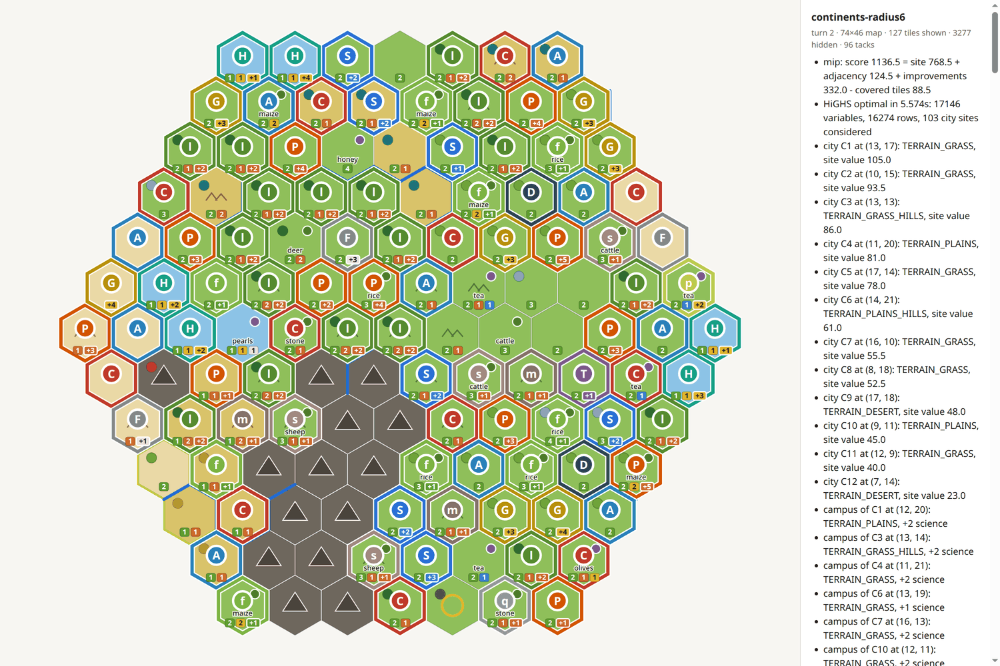

# civ6-planner

Plans where to found cities and place districts and tile improvements in
**Civilization VI: Gathering Storm**, from the part of the map you have revealed, and
shows the plan in game as map tacks.

A small Lua mod writes the map into your saves; a Python tool reads it, solves a
mixed-integer programme (HiGHS) that maximises yields under the game's placement rules,
and writes the plan back for the mod to place as tacks.



```
Civ VI + Map Dump mod ──(map dump inside each save)──▶ civ6-planner plan
        ▲                                                      │
        └──── Ctrl+Shift+T places the tacks ◀── mod/…/mapdump_plan.lua
```

> **Status:** a personal project, developed and tested only on the **native Linux
> (Aspyr) port under Steam**. Other platforms should work if `CIV6_USER_DIR` points at
> the game's user folder (the one holding `Mods`, `Saves` and `Cache`), but that is
> untested.

## What the plan contains

With the default settings (`config/default.toml`) the optimiser:

- founds **as many new cities as fit** in the revealed area, more than 3 tiles from
  any city, on the best sites;
- gives each city (new, and your existing ones) up to **3 specialty districts**
  (Campus, Industrial Zone, Commercial Hub, Holy Site, Theater, Encampment, Harbor),
  plus an **Aqueduct** and a **Dam** where the game allows them;
- gives each city up to **5 tile improvements** (Farm, Mine, Quarry, Plantation, Camp,
  Pasture, Fishing Boats, Lumber Mill), on the tiles worth working;
- maximises the cities' site yields + the districts' adjacency bonuses + the improved
  tiles − the yields of the tiles districts cover, with food, production and science
  weighted most.

Placement and adjacency rules are read from the game's own database, so they follow
the rules set and mods you play with. The full formulation is in
[`docs/model.html`](docs/model.html) (open it in a browser; it renders the maths with
KaTeX). Tiles holding one of your own map tacks are left alone.

## Setup

Requirements: Civilization VI with Gathering Storm, Python 3.11+, and
[uv](https://docs.astral.sh/uv/).

```bash
git clone https://github.com/pierreosselin/civ6-planner.git
cd civ6-planner
uv sync                        # creates .venv with the dependencies (SciPy) and the tool
source .venv/bin/activate      # or prefix each command with `uv run`
civ6-planner install-mod       # copies mod/mapdump into the game's Mods folder
```

Then start Civ VI, enable **Map Dump** under Additional Content, and start or load a
game. The mod's `.modinfo` is only read at start-up: restart the game after installing
or updating the mod.

## Using it in a game

1. **Save** the game (the mod stores the revealed map at load and at the start of
   each turn; the save carries it out of the game).
2. Plan from the newest save:
   ```bash
   civ6-planner plan            # writes the plan the mod reads
   civ6-planner plan --dry-run  # print it only
   civ6-planner watch           # re-plan after every save (autosaves included)
   ```
3. Press **Ctrl+Shift+T** in game: the tacks appear, named per city ("City C1",
   "Campus C1", "Campus Rome"); no reload needed.

| In game | |
|---|---|
| **Ctrl+Shift+T** | place the planned tacks (re-reads the plan file) |
| **Ctrl+Shift+C** | remove the planner's tacks |
| **Ctrl+Shift+X** | remove every tack, yours too |
| **Ctrl+Shift+F** | capture the whole map, fog ignored, into the next save (for test maps) |

The planner's tacks are named `[MD] …` and only those are ever moved or removed. With
[Detailed Map Tacks](https://steamcommunity.com/sharedfiles/filedetails/?id=2428969051)
enabled, each tack shows the adjacency bonus it would get.

## Settings

Every parameter (cities to found, districts and improvements to plan, yield weights,
per-city limits, solver time limit and gap) is in `config/default.toml`. Override some
of them for one run with a small TOML file that sets only what changes:

```bash
civ6-planner plan --config config/science.toml     # science weighted 3
```

## Developing without the game

`data/<case>/` holds test cases: `map.json` (a map captured from a real game) and
`config.toml` (settings for that case). `continents` and `shuffle` are fully revealed
74×46 maps; `*-revealed` and `*-radius6` are what a player sees early on.

```bash
civ6-planner results -o results/run1                              # every test case
civ6-planner results --only continents-radius6 -o results/run1    # one case, by name
civ6-planner view --map continents-radius6 --plan --open          # one map page
uv run python -m unittest discover -s tests                       # tests
```

`results` prints each run as it goes (map statistics, the model as it is built, the
solver's log, a summary with the share of cities getting each district) and writes
`results/<run>/`: an `index.html` linking a map page per case (pan, zoom, hover a
tile; every tack listed in the side panel), plus `decisions.json`, `optimisation.log`
and `run.log`.

New test maps: in a throwaway game press Ctrl+Shift+F, save, then
`civ6-planner dump --full -o data/NAME/map.json`; `make-map` cuts masked versions
(`--mask revealed|radius|blob`).

## Layout

| Path | What |
|---|---|
| `src/civ6_planner/model.py` | the optimiser: the MIP, one function per variable, constraint and objective term |
| `src/civ6_planner/solver.py` | small modelling layer over HiGHS (`scipy.optimize.milp`) |
| `src/civ6_planner/rules.py` | placement and adjacency rules from the game database |
| `src/civ6_planner/gamemap.py` | the map: tiles, hex distance (odd-r, east–west wrap), rivers |
| `src/civ6_planner/config.py` | settings: `config/default.toml`, case and `--config` overrides |
| `src/civ6_planner/planner.py` | runs a planner and turns its plan into named tacks |
| `src/civ6_planner/results.py`, `metrics.py` | results folders, logs and plan statistics |
| `src/civ6_planner/dump.py`, `tacks.py` | reading map dumps out of saves; writing the plan for the mod |
| `src/civ6_planner/viewer.py`, `dataset.py` | the HTML map page; test cases and masks |
| `mod/mapdump/` | the Civ VI mod (Lua) |
| `docs/model.html` | the model's maths |
| `CLAUDE.md`, `.claude/skills/` | working notes for [Claude Code](https://claude.com/claude-code), with which this is developed |

## Notes on the Linux (Aspyr) port

Found while getting data in and out of the game; worth knowing before changing the mod:

- No `Lua.log` is ever written, `print()` goes nowhere visible, and
  `UIManager:SetClipboardString` doesn't reach the desktop clipboard.
- A mod's own UI context (`AddUserInterfaces`) never runs. The working entry point is
  `ReplaceUIScript` on `StatusMessagePanel`, which includes the original panel script.
- What does work: `GameConfiguration.SetValue` (the value lands in the next save, partly
  zlib-compressed) to get data out, and `include()` of a mod file (re-read from disk on
  each call) to get a new plan in mid-game.
- Deleting map pins inside a `GetMapPins()` loop crashes the game once there are a few
  dozen: collect the ids first.
- Use lowercase file names in mods.

## Not modelled yet

Timing (which city grows when, what to build first), most adjacency between planned
districts of different cities, technology- and civic-gated rules, tile ownership,
other districts (Entertainment Complex, Government Plaza, Canal, ...), wonders. See
the last section of [`docs/model.html`](docs/model.html).

## Licence

[MIT](LICENSE). Civilization VI is a trademark of Take-Two Interactive; this project is not
affiliated with or endorsed by Firaxis Games or 2K.
